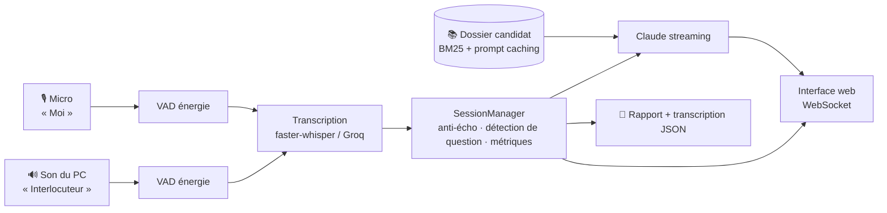

# 🎯 Interview Coach

Copilote d'entretien technique propulsé par **Claude** : il écoute l'échange, transcrit en temps réel,
distingue votre voix de celle de l'interlocuteur, détecte les questions et affiche en quelques secondes une
proposition de réponse appuyée sur **votre propre dossier** (CV, fiches projets). En fin de session, il produit
un **rapport de coaching** noté question par question.

Inspiré de l'architecture de [Natively](https://github.com/BrdgAI/Natively), réécrit de zéro en Python.

## Fonctionnalités

| | |
|---|---|
| 🎙️ **Deux canaux audio** | Micro = vous, son du PC (loopback WASAPI) = interlocuteur. Séparation des voix fiable, sans diarisation hasardeuse. |
| ✍️ **Transcription** | `faster-whisper` en local (gratuit, privé) ou Groq Whisper large-v3-turbo (≈ 300 ms). Filtre anti-hallucinations Whisper. |
| ❓ **Détection de questions** | Heuristiques FR/EN + déclenchement manuel (`Ctrl+Entrée`). Une nouvelle question annule la suggestion en cours. |
| 🧠 **Claude en streaming** | Réponse structurée « À dire / Points clés / Exemple », lisible en 5 secondes. Dossier candidat en **prompt caching**. |
| 🗂️ **Import Notion** | Le dossier candidat est lu directement depuis vos pages Notion (ex. « Mon CV décortiqué » et ses sous-pages) : aucun fichier local. |
| 📚 **RAG intégré** | Petit dossier → injecté en entier (mis en cache). Gros dossier → recherche BM25 (sans API d'embeddings). |
| 🔁 **Anti-écho** | Si le micro capte la voix de l'interlocuteur sortant des haut-parleurs, le doublon est ignoré. |
| 🎤 **Mode simulation** | Claude joue un recruteur technique exigeant, à partir de l'offre que vous collez. |
| 🙈 **Mode coach** | Suggestion floutée : vous répondez d'abord, vous comparez ensuite. |
| 📝 **Rapport de session** | Note /10, analyse par question, meilleure réponse, notions à réviser, plan d'entraînement + métriques de latence. |

## Architecture



```
coach/
├── audio.py      capture 2 canaux + VAD
├── stt.py        transcription (local / Groq) + nettoyage
├── detector.py   détection de questions, anti-écho
├── knowledge.py  chargement des documents, découpage, BM25
├── notion_source.py  import du dossier depuis Notion (API officielle)
├── llm.py        prompts et appels Claude (streaming, simulation, rapport)
├── session.py    orchestration temps réel et métriques
├── server.py     API FastAPI + WebSocket
└── static/index.html  interface
```

## Installation express (Windows 10/11)

1. Installez **Python 3.12** depuis python.org en cochant **« Add python.exe to PATH »**.
2. Sur GitHub : **Code → Download ZIP**, puis décompressez (ou `git clone`).
3. Double-cliquez **`install.bat`** (5 à 10 min). Le fichier `.env` s'ouvre : collez vos clés
   (`ANTHROPIC_API_KEY`, `GROQ_API_KEY` gratuite sur console.groq.com, `NOTION_TOKEN`), enregistrez.
4. Double-cliquez **`start.bat`** : l'outil s'ouvre dans sa propre fenêtre, comme une application.

## Installation manuelle

Prérequis : **Python 3.11 ou 3.12** ([python.org](https://www.python.org/downloads/), cochez « Add to PATH ») et Git.

```powershell
git clone https://github.com/clementmamapro-creator/interview-coach.git
cd interview-coach
python -m venv .venv
.venv\Scripts\activate
pip install -r requirements.txt
copy .env.example .env
notepad .env          # collez votre ANTHROPIC_API_KEY
```

### Brancher votre dossier Notion (recommandé)

1. Allez sur [notion.so/profile/integrations](https://www.notion.so/profile/integrations) → **Nouvelle intégration** (type interne, lecture seule suffit) → copiez le token.
2. Dans Notion, ouvrez la page racine (ex. « Mon CV décortiqué ») → **•••** → **Connexions** → ajoutez l'intégration. Les sous-pages sont incluses automatiquement.
3. Dans `.env` : `NOTION_TOKEN=…` et `NOTION_PAGES=<URL de la page>` (plusieurs pages séparées par des virgules).

L'import se fait au démarrage (environ 30 s pour une dizaine de fiches, limite de débit Notion) et via « Recharger ».
Alternative : déposer des fichiers `.md`, `.txt` ou `.pdf` dans `knowledge/`.

Puis :

```powershell
python run.py               # ouvre http://127.0.0.1:8765
python run.py --devices     # liste les micros / sorties si besoin
```

Au premier lancement en mode `local`, le modèle Whisper est téléchargé (≈ 500 Mo pour `small`).

## Utilisation

1. Collez l'offre d'emploi dans « Poste visé ».
2. **Entraînement** : cliquez « Question suivante (simulation) », répondez à voix haute, comparez avec la suggestion.
3. **Écoute** : « ▶ Écouter » capte micro + son du PC (vidéo d'entretien, appel d'entraînement avec un ami…).
4. **Sans audio** : tapez une question en bas puis « Poser » (`Entrée`) ; votre réponse avec « Ma réponse » (`Maj+Entrée`).
5. « 📝 Rapport de session » : analyse complète, enregistrée dans `sessions/`.

🎧 Utilisez un casque : le micro ne capte alors que vous.

**Tester avec un ami** : il doit vous appeler sur le PC (Teams, Meet, Discord, WhatsApp Web). Sa voix sort du PC et
est captée comme « Interlocuteur ». S'il est dans la même pièce, le micro capte vos deux voix comme « Moi » et aucune
suggestion ne se déclenche.

## Tests

```bash
pip install pytest
python -m pytest -q
```

Les tests couvrent le VAD, la détection de questions, l'anti-écho, le RAG, l'orchestration (moteur Claude simulé)
et l'API, sans matériel audio ni clé.

## Feuille de route

- [ ] Transcription en streaming (résultats partiels) pour réduire encore la latence
- [ ] Diarisation par empreinte vocale (pyannote / ECAPA) pour les entretiens en présentiel sur un seul micro
- [ ] Recherche hybride BM25 + embeddings locaux
- [ ] Banque de questions par métier (Data Engineer, AI Engineer, BI) et suivi de progression entre sessions
- [ ] Application desktop (Tauri) et LLM local via Ollama en secours
- [ ] Tableau de bord des métriques (latence, notes par thème)

## Licence

MIT — © 2026 Clément Ferry Mama (MCF World)
